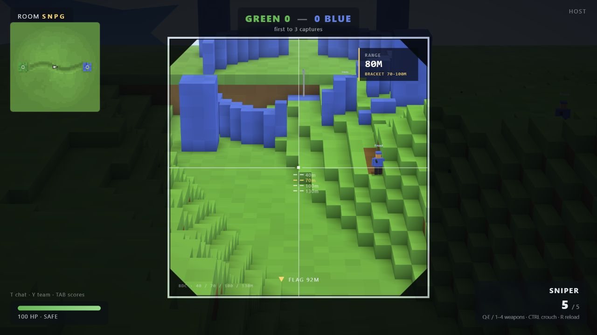
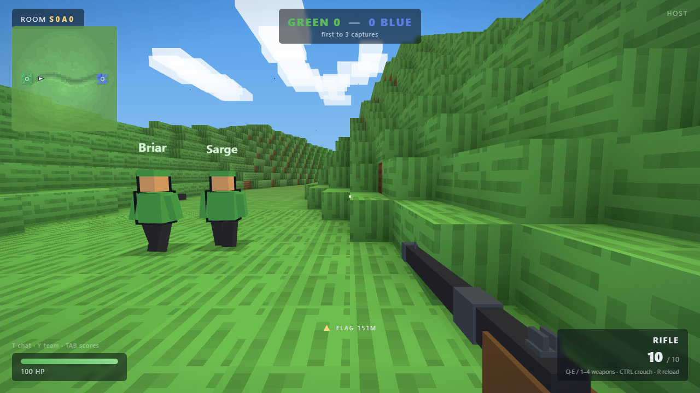
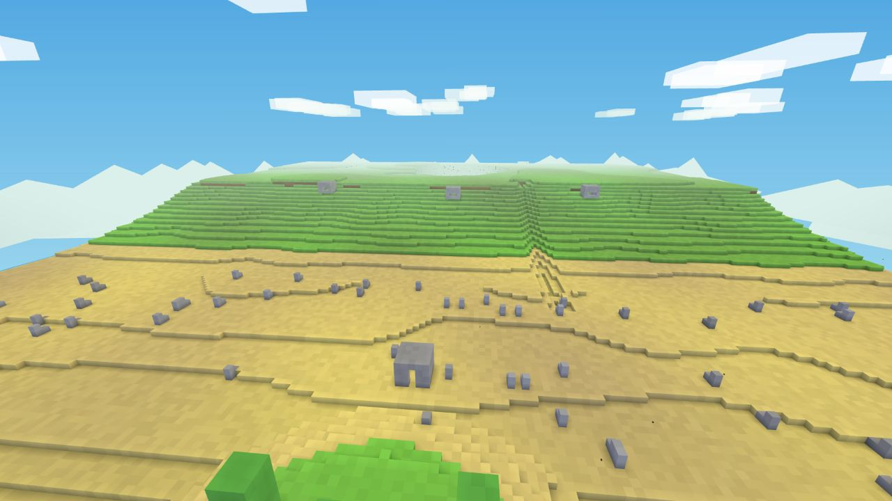
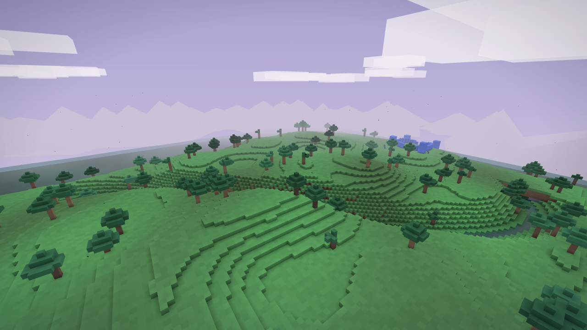
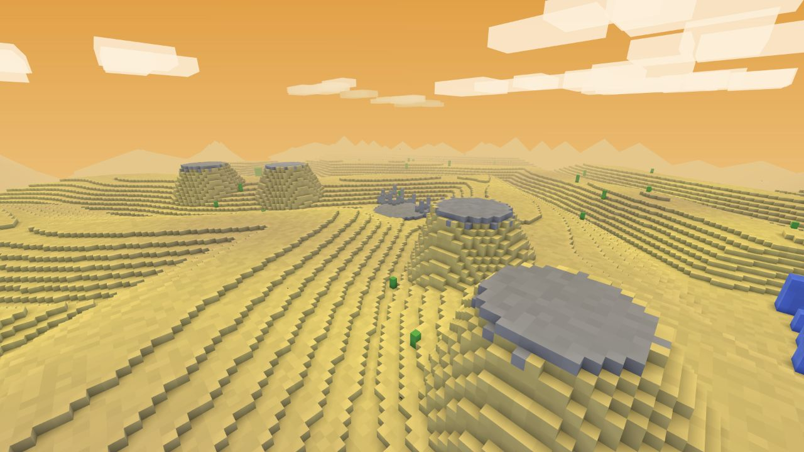
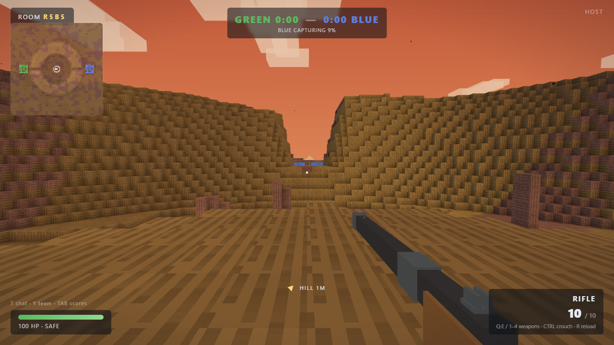
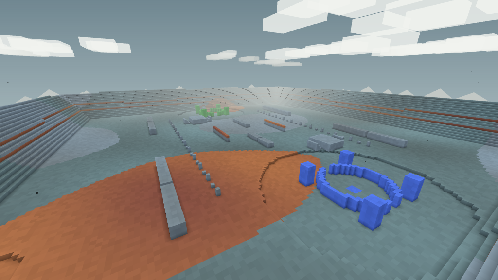
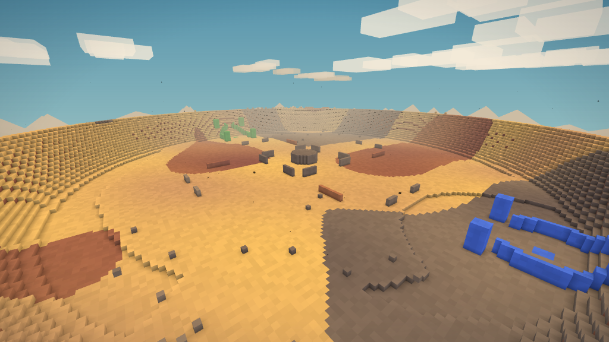

# SPADEFALL

A browser shooter where every wall can become a doorway.

[Play Spadefall](https://spadefall.io/)



Spadefall is a first-person arena shooter built around terrain that can be destroyed and rebuilt during a match. Dig through cover with a spade, blast open a route with grenades, or place blocks to close a lane behind you. The current build runs in the browser and supports solo play with bots, private rooms, and public quick match.

## Matches

Rooms support up to ten human players, split into teams of five. Bots occupy open positions, so a match can start immediately and fill with people as they join.

Bots use line of sight, nearby sound, and fading last-known positions rather than hidden player coordinates. Their team jobs change with the mode: they escort and recover flags, anchor or flank rotating hills, and spread pressure across deathmatch lanes. Tap `G` for a quick team ping, or hold it and press `1`–`5` to mark attack, defense, a breach, cover construction, or a rotation. Pings can direct nearby available bots without pulling flag carriers or emergency recovery teams away from their jobs.

| Mode | Win condition | Maps |
| --- | --- | --- |
| Team Deathmatch | First to 150 kills or 15:00 | Greenbelt, Beachhead, Pinefall |
| King of the Hill | Occupy rotating points for 10 minutes or 15:00 | Caldera |

These limits apply to solo, private, and public matches. Score targets can end a round early; tied rounds can enter overtime. The longer rounds give players more time to build and use terrain before the map resets.

Capture the Flag is retired from public play. Dunes, Crown, Foundry, and Faultline are also retired from normal matchmaking and hosting. They remain playable in development rooms started with the `privateContent` feature.

Terrain changes remain in the match state. Late joiners receive the current battlefield, including dug tunnels, collapsed cover, and placed blocks.

After a round, the match report shows contribution, combat and objective work, a descriptive team role, teammate commendations, and a paired start/finish view of how the terrain changed. Personal records are tracked separately for CTF, deathmatch, and king of the hill in the current browser. Players choose from three mode/map cards; PLAY ANOTHER starts the selected battle immediately, DONE leaves, and an unanswered room advances after the bounded results window. When at least two humans are present, everyone can also opt into a rivalry round on the same map and seed with sides rebalanced.

## Loadouts and tools

Choose one gun for each life. Every class also carries a spade, 50 building blocks, and regenerating grenades. Terrain actions that create a useful breach, cover a teammate, interrupt a sightline, collapse terrain onto a fight, or enable a teammate's route can earn bounded engineering assists.

| Weapon | Role |
| --- | --- |
| Rifle | Hard-hitting semi-automatic fire with moderate zoom |
| SMG | Fast automatic fire for close fights |
| Sniper | Bolt-action precision with a calibrated scope reticle |

The sniper cross is its aiming reticle, with range marks below it for bullet drop. A brief gold X confirms a hit; a larger red X confirms a kill. These hit markers fade automatically and are separate from the aiming sights.

The ballistics model includes recoil, spread, range compensation, and bullet drop. The first-person weapon models provide working iron sights and scope alignment. Lifetime match contribution advances a mastery rank without changing weapon stats.

Contribution earned during one life fills the air-support meter. Kills,
assists, flag play, hill occupation, defense, and escorts all count. At 700
points, press `F` to pilot an airstrike marker and choose the impact point.

## Maps

Each map has its own terrain generator, atmosphere, sight lines, water layout, and supported modes.

| | |
| --- | --- |
|  |  |
| Greenbelt | Beachhead |
|  |  |
| Pinefall | Dunes |
|  |  |
| Caldera | Foundry |
|  | |
| Faultline | |

Foundry, Faultline, Dunes, and Crown remain available in private development rooms only.

## Multiplayer

Spadefall uses a host-authoritative WebRTC room. The host validates combat, movement, objectives, terrain edits, tactical pings, and votes; other players connect directly through PeerJS. Public matchmaking scans a fixed pool of quick-match rooms, while private rooms have copyable invite links and four-character codes. If a host leaves, another player can take over from the replicated match state. With at least three humans, players can call a short, majority vote to remove a non-host cheater or griefer. Because the host owns the simulation, the safe response to a malicious host is to leave that room.

Room-wide chat is disabled by default; `Y` opens transient team chat. Callsigns are normalized and checked for profanity on the joining browser and again by the room host. The current [privacy notice, terms, and community rules](legal.html) describe what the shipped peer-to-peer game stores and shares.

## Controls

| Input | Action |
| --- | --- |
| `W A S D` | Move |
| `Space` | Jump or swim upward |
| `Shift` | Sprint |
| `Ctrl` | Crouch, ledge grip, or swim downward |
| Mouse | Look |
| Left mouse | Fire or use the selected tool |
| Right mouse | Aim |
| `R` | Reload |
| `1`, `Q`, `E` | Select or cycle the gun |
| `2` | Spade |
| `3` | Blocks |
| `V` | Cycle the block tool between single placement, low wall, firing step, and ramp blueprints |
| `4` | Grenade |
| `F` | Call in an airstrike when the meter is full |
| `G` | Tap for a team ping; hold and press `1`–`5` for an intent ping |
| `Tab` | Scoreboard |
| `Y` | Team chat |
| `M` | Mute or unmute all game audio |

## Display settings

Low, Medium, and High graphics presets adjust render resolution, antialiasing, ambience, water effects, tracers, casings, and debris without changing how far players can see. The menu also includes:

- HUD scale and opacity controls
- Reduced camera motion
- An accessible orange and blue team palette
- Optional FPS and performance counters
- Mouse sensitivity and master volume

## How it is built

The game is plain HTML, CSS, and JavaScript modules. Three.js r170 and PeerJS are vendored in the repository, so the production game has no package install or build step. Playwright is a development-only dependency for the two-browser multiplayer test.

- A `256 x 64 x 256` voxel world stored in typed arrays
- `16 x 16` terrain chunks with queued remeshing after edits
- Seeded procedural map generation
- Host-authoritative hits, explosions, objectives, and terrain changes
- Browser-to-browser networking over WebRTC
- Synthesized positional audio through the Web Audio API
- Headless regression tests for gameplay, networking, validation, and map rules

## Run locally

Clone the repository and serve it as static files:

```sh
git clone https://github.com/brookskc/spadefall.git
cd spadefall
python -m http.server 8000
```

Open `http://localhost:8000`. Browsers block JavaScript modules when `index.html` is opened directly from disk, so a local HTTP server is required.

Install the test tooling, then run the deterministic suite and real-browser multiplayer test:

```sh
npm install
npm test
npm run test:multiplayer
```

Run both suites in the same order as CI with `npm run test:ci`.

For bot tuning, append `?botq=easy`, `?botq=normal`, or `?botq=hard` to the local URL. Difficulty changes reaction time, aim error, memory, hearing, and decision cadence; it does not change bot health or weapon damage. In a solo or hosted match, `/botstats` reports bot performance and `/playteststats` reports bounded, local-only match aggregates for flow, classes, lanes, KOTH activity, engineering, pings, and continuation choices.

## License

Spadefall is available under the [PolyForm Noncommercial License 1.0.0](LICENSE).
