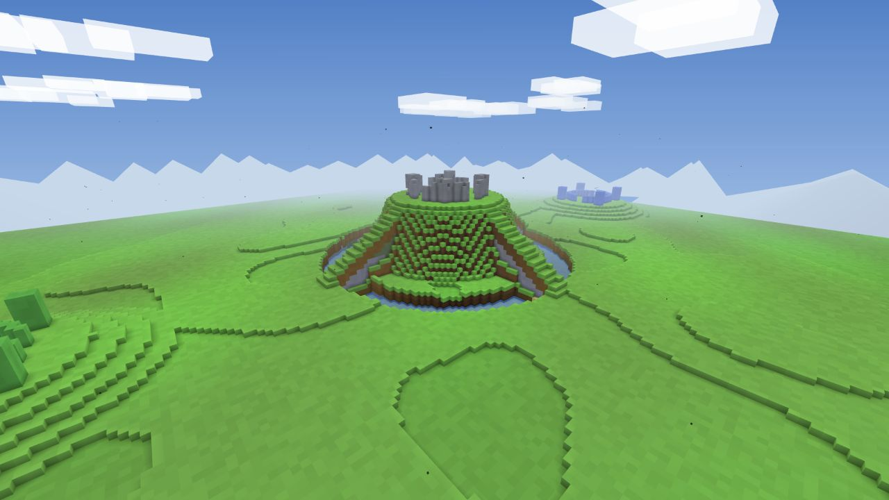

# SPADEFALL

A browser shooter where every wall can become a doorway.

[Play Spadefall](https://spadefall.io/)


Spadefall is a first-person arena shooter built around terrain that can be destroyed and rebuilt during a match. Dig through cover with a spade, blast open a route with grenades, or place blocks to close a lane behind you. The current build runs in the browser and supports solo play with bots, private rooms, and public quick match.

## Matches

Rooms support up to ten human players, split into teams of five. Bots occupy open positions, so a match can start immediately and fill with people as they join.

Bots use line of sight, nearby sound, and fading last-known positions rather than hidden player coordinates. Their team jobs change with the mode: they escort and recover flags, anchor or flank rotating hills, and spread pressure across deathmatch lanes. Team pings made with `G` send the nearest available bots to the mark without pulling flag carriers or emergency recovery teams away from their jobs.

| Mode | Win condition | Maps |
| --- | --- | --- |
| Capture the Flag | First to three captures | Greenbelt, Beachhead, Pinefall |
| Team Deathmatch | First to 30 kills | All maps |
| King of the Hill | Capture and occupy rotating points for 120 seconds | Dunes, Crown, Caldera |

Terrain changes remain in the match state. Late joiners receive the current battlefield, including dug tunnels, collapsed cover, and placed blocks.

Each battlefield also has two neutral field caches built from ordinary voxels. Hold one uncontested for two seconds to replenish construction blocks and a grenade for nearby teammates. Once used, the cache takes 30 seconds to recharge.

After a round, the match report shows your contribution score, combat line, objective work, placement, and any performance medals. Personal records are tracked separately for CTF, deathmatch, and king of the hill in the current browser. Players can vote for an immediate rematch; otherwise the room continues through its map rotation.

## Loadouts and tools

Choose one gun for each life. Every class also carries a spade, 50 building blocks, and regenerating grenades.

| Weapon | Role |
| --- | --- |
| Rifle | Hard-hitting semi-automatic fire with moderate zoom |
| SMG | Fast automatic fire for close fights |
| Sniper | Bolt-action precision with a calibrated scope reticle |

The ballistics model includes recoil, spread, range compensation, and bullet drop. The first-person weapon models provide working iron sights and scope alignment. Lifetime match contribution advances a mastery rank without changing weapon stats.

Contribution earned during one life fills the combat-momentum meter. Kills,
assists, flag play, hill occupation, defense, and escorts all count. Press `F`
to spend the strongest available reward:

- 500 points: Overcharge. A visible 1.25-second charge-up precedes 12 seconds of increased outgoing damage and increased incoming risk.
- 1,000 points: Pilot an airstrike marker and choose the impact point.

## Maps

Each map has its own terrain generator, atmosphere, sight lines, water layout, and supported modes.

| | |
| --- | --- |
|  |  |
| Greenbelt | Beachhead |
|  |  |
| Pinefall | Dunes |
|  |  |
| Crown | Caldera |

## Multiplayer

Spadefall uses a host-authoritative WebRTC room. The host validates combat, movement, objectives, terrain edits, tactical pings, and rematch votes; other players connect directly through PeerJS. Public matchmaking scans a fixed pool of quick-match rooms, while private rooms have copyable invite links and four-character codes. If a host leaves, another player can take over from the replicated match state.

## Controls

| Input | Action |
| --- | --- |
| `W A S D` | Move |
| `Space` | Jump or swim upward |
| `Shift` | Sprint |
| `Ctrl` | Crouch, ledge grip, or swim downward |
| Mouse | Look |
| Left mouse | Fire or use the selected tool |
| Right mouse | Aim |
| `R` | Reload |
| `1`, `Q`, `E` | Select or cycle the gun |
| `2` | Spade |
| `3` | Blocks |
| `4` | Grenade |
| `F` | Use the available streak ability |
| `G` | Place a team-only tactical ping |
| `Tab` | Scoreboard |
| `T` / `Y` | Room chat / team chat |

## Display settings

Low, Medium, and High graphics presets adjust render resolution, antialiasing, ambience, water effects, tracers, casings, and debris without changing how far players can see. The menu also includes:

- HUD scale and opacity controls
- Reduced camera motion
- An accessible orange and blue team palette
- Optional FPS and performance counters

## How it is built

The game is plain HTML, CSS, and JavaScript modules. Three.js r170 and PeerJS are vendored in the repository, so the production game has no package install or build step. Playwright is a development-only dependency for the two-browser multiplayer test.

- A `256 x 64 x 256` voxel world stored in typed arrays
- `16 x 16` terrain chunks with queued remeshing after edits
- Seeded procedural map generation
- Host-authoritative hits, explosions, objectives, and terrain changes
- Browser-to-browser networking over WebRTC
- Synthesized positional audio through the Web Audio API
- Headless regression tests for gameplay, networking, validation, and map rules

## Run locally

Clone the repository and serve it as static files:

```sh
git clone https://github.com/brookskc/spadefall.git
cd spadefall
python -m http.server 8000
```

Open `http://localhost:8000`. Browsers block JavaScript modules when `index.html` is opened directly from disk, so a local HTTP server is required.

Install the test tooling, then run the deterministic suite and real-browser multiplayer test:

```sh
npm install
npm test
npm run test:multiplayer
```

Run both suites in the same order as CI with `npm run test:ci`.

For bot tuning, append `?botq=easy`, `?botq=normal`, or `?botq=hard` to the local URL. Difficulty changes reaction time, aim error, memory, hearing, and decision cadence; it does not change bot health or weapon damage. In a solo or hosted match, `/botstats` in chat reports average decision time, stuck recoveries, and objective participation.

## License

Spadefall is available under the [PolyForm Noncommercial License 1.0.0](LICENSE).
